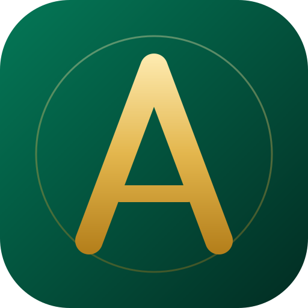

[English](/README.md) | [فارسی](/README.fa_IR.md)

<div align="center">

#  Aurelle

[](https://opensource.org/licenses/MIT)

**پیام‌رسان خصوصی و self-hosted با تماس رمزنگاری‌شده‌ی سرتاسری و پیام‌های ویدیویی گرد.**

</div>

Aurelle یک فورک از [Songbird](https://github.com/bllackbull/Songbird) (با لایسنس MIT) است که تماس صوتی و تصویری با رمزنگاری سرتاسری و پیام‌های ویدیویی گرد به سبک تلگرام را اضافه می‌کند و با هدف مصرف کم باتری و اینترنت موبایل ساخته شده است. نام آن از واژه‌ی لاتین *aurum* به معنی طلا گرفته شده است.

## قابلیت‌های کلیدی

- 📞 **تماس رمزنگاری‌شده**: تماس صوتی و تصویری یک‌به‌یک با رمزنگاری سرتاسری، همتا به همتا، با کد اموجی تأیید و شماره‌ی ایمنی
- ⭕ **پیام ویدیویی گرد**: ضبط تا ۶۰ ثانیه که روی دستگاه خودتان رمز می‌شود؛ گیرنده فقط هنگام پخش دانلود و رمزگشایی می‌کند
- 🔋 **سبک برای باتری و اینترنت**: Opus با DTX و ۲۴ کیلوبیت، کدک‌های سازگار با سخت‌افزار، ویدیوی تطبیقی که به صدا-فقط برمی‌گردد و آزاد کردن دوربین در پس‌زمینه
- 🛡️ **گزینه‌ی امنیت بالا**: عبور همه‌ی تماس‌ها از رله‌ی خودتان تا طرفین آدرس IP یکدیگر را نفهمند
- 💬 **انواع چت**: پیام مستقیم، گروه و کانال
- 📁 **پشتیبانی از رسانه**: آپلود فایل، پیام صوتی، تبدیل ویدئو
- 🔔 **Push Notification**: اعلان وب با VAPID (برای تماس ورودی هم)
- 📡 **کانال‌های ریموت**: آینه‌کردن کانال‌های Telegram یا Songbird
- 🛡️ **پنل مدیریت**: رابط مدیریتی کامل با نقش مالک
- 🔒 **امنیت**: رمزنگاری در حالت ذخیره، هش bcrypt، محدودیت نرخ
- 📱 **PWA**: اپلیکیشن وب نصب‌شدنی
- ☁️ **نصب ابری**: نصب به صورت PaaS و CaaS با پشتیبانی از فضای ابری
- 🌍 **چندزبانه**: پشتیبانی از انگلیسی و فارسی

## چه چیزی رمزنگاری سرتاسری می‌شود

| | رمزنگاری سرتاسری |
|---|---|
| صدا و تصویر تماس | ✅ |
| سیگنالینگ تماس (SDP و ICE) | ✅ |
| پیام‌های ویدیویی گرد (و پیش‌نمایش آن‌ها) | ✅ |
| پیام‌های متنی، پیام‌های صوتی، فایل‌ها | ❌ (روی سرور در حالت ذخیره رمز می‌شوند) |

سرور همچنان فراداده را می‌بیند (چه کسی با چه کسی، چه زمانی، حجم‌ها). پیش از تکیه بر آن، [مدل تهدید](docs/fa/E2EE-Protocol.md#threat-model) را بخوانید: مانند هر رمزنگاری سرتاسری مبتنی بر مرورگر، کد توسط سرور تحویل داده می‌شود؛ پس شماره‌های ایمنی را با افرادی که برایتان مهم هستند تأیید کنید.

## نصب سریع

Aurelle از روی سورس ساخته می‌شود. با Docker:

```bash
git clone https://github.com/elia2000/Aurelle.git
cd Aurelle
cp .env.example .env
docker compose up -d --build
```

یا روی یک سرور Ubuntu (نسخه 22.04+) با دسترسی `sudo` از اسکریپت نصب استفاده کنید:

```bash
curl -fsSL https://raw.githubusercontent.com/elia2000/Aurelle/main/scripts/install.sh | bash
```

> [!TIP]
> داشتن یک دامنه که به IP عمومی سرور شما اشاره کند پیشنهاد می‌شود. برای تماس، پیام ویدیویی و push notification **به HTTPS نیاز دارید** (به‌جز روی `localhost`).

برای تماس بین شبکه‌های مختلف، رله‌ی همراه پروژه را فعال کنید: پس از تنظیم `CALLS_TURN_SECRET`، `CALLS_TURN_URLS` و `CALLS_TURN_EXTERNAL_IP` در `.env` دستور `docker compose --profile calls up -d` را اجرا کنید. [تماس‌ها و پیام‌های ویدیویی](docs/fa/Calls-and-Video-Messages.md) را ببینید.

> [!NOTE]
> نام‌های داخلی (سرویس Docker با نام `songbird`، دستور `songbird-deploy`، فایل `songbird.db` و کلیدهای cookie و storage) از پروژه‌ی اصلی حفظ شده‌اند تا نصب‌های موجود به کار خود ادامه دهند.

## مستندات

مستندات در پوشه‌ی [`docs/`](docs/) قرار دارد (VitePress، انگلیسی و فارسی). برای مرور محلی `npm run docs:dev` را اجرا کنید.

- [تماس‌ها و پیام‌های ویدیویی](docs/fa/Calls-and-Video-Messages.md)
- [پروتکل رمزنگاری سرتاسری](docs/fa/E2EE-Protocol.md) (برای توسعه‌دهندگان اپلیکیشن بومی)
- [اسکریپت نصب](docs/fa/Deployment-Script.md)
- [نصب از طریق Docker](docs/fa/Installation-Docker.md)
- [نصب ابری](docs/fa/Cloud-Deployment.md)
- [نصب دستی](docs/fa/Manual-Installation.md)
- [کانفیگ Nginx](docs/fa/Nginx-Configuration.md)
- [گواهی‌های SSL](docs/fa/SSL-Certificates.md)
- [متغیرهای محیطی](docs/fa/Environment-Variables.md)
- [فضای ابری](docs/fa/Object-Storage.md)
- [ورکر مدیا](docs/fa/Media-Worker.md)
- [پنل مدیریت](docs/fa/Admin-Panel.md)
- [عیب‌یابی](docs/fa/Troubleshooting.md)

## قدردانی

Aurelle بر پایه‌ی [Songbird](https://github.com/bllackbull/Songbird) ساخته‌ی [@bllackbull](https://github.com/bllackbull) و مشارکت‌کنندگان آن ([@nkhalili](https://github.com/nkhalili)، [@modos](https://github.com/modos)، [@iPmartNetwork](https://github.com/iPmartNetwork)) است و تحت لایسنس MIT منتشر می‌شود. اعلان کپی‌رایت آن‌ها در [LICENSE](LICENSE) حفظ شده است.

## مشارکت

issue و pull request خوش‌آمد است. [Contributing](/CONTRIBUTING.md) را ببینید.

## لایسنس

این پروژه تحت لایسنس MIT منتشر شده است. برای جزئیات بیشتر، فایل [LICENSE](LICENSE) را ببینید.
